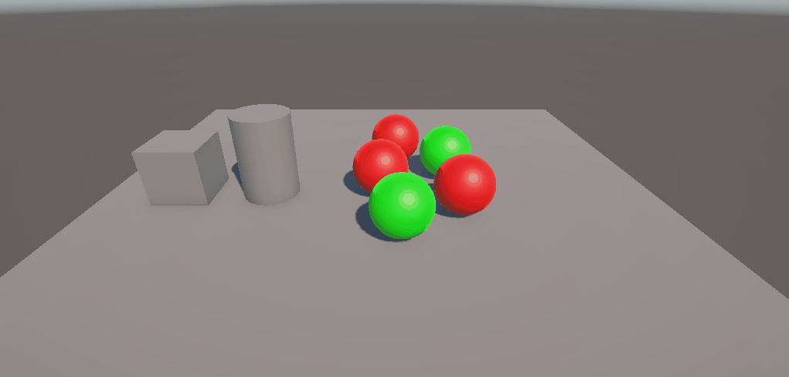
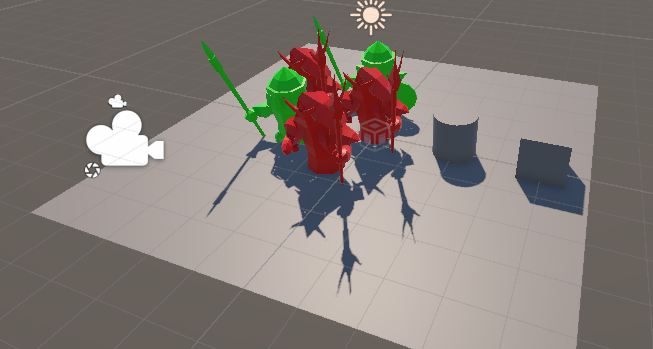
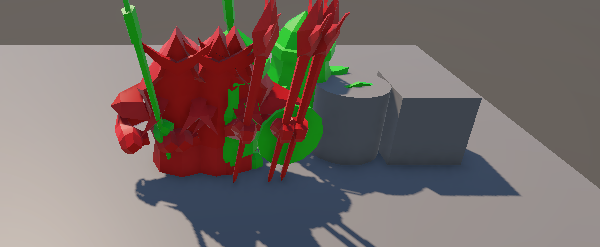
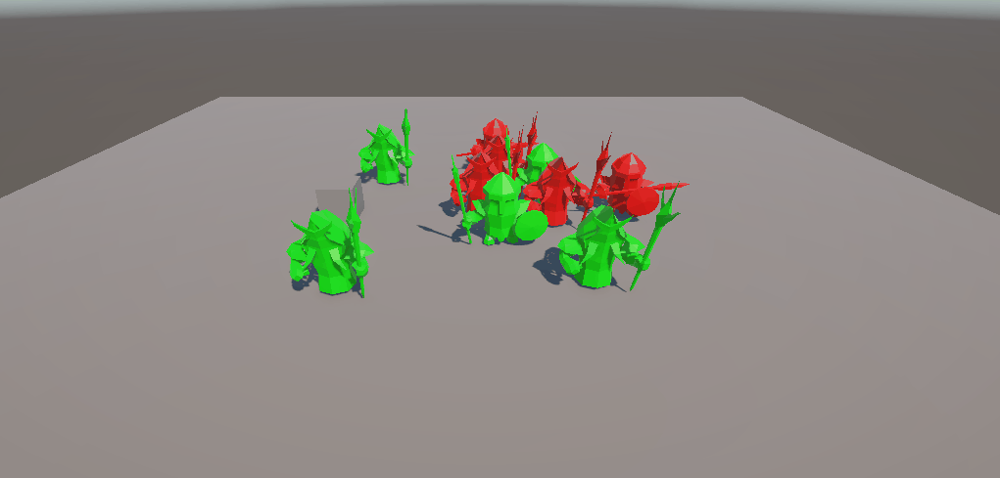
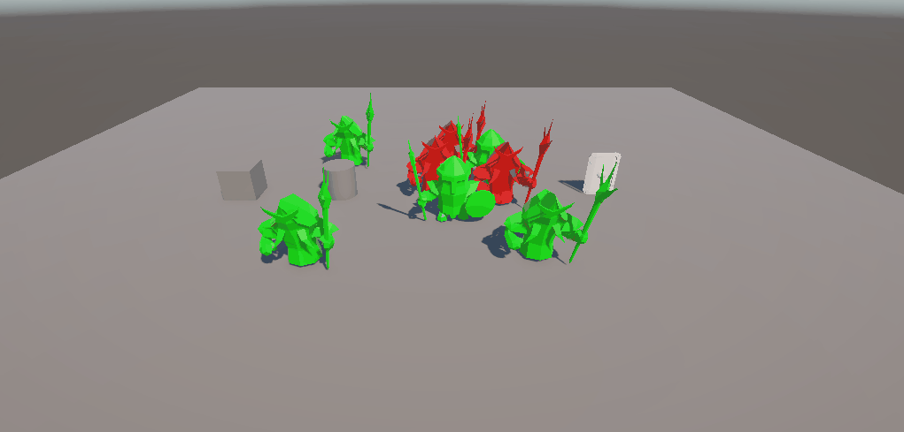
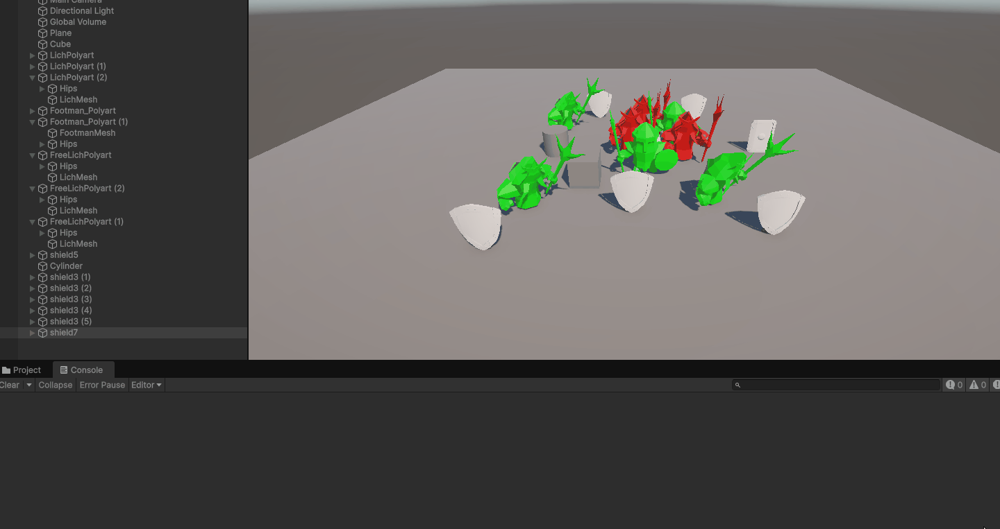
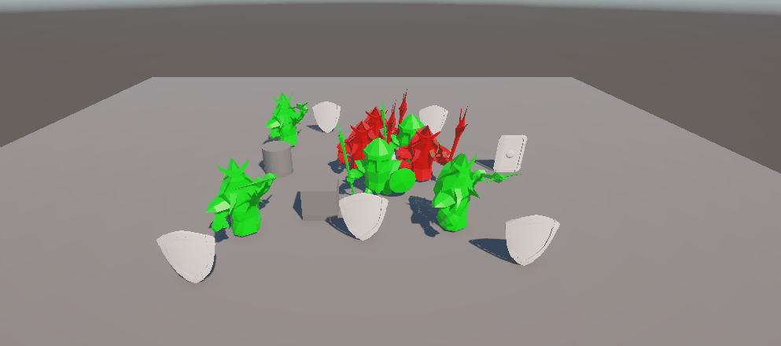
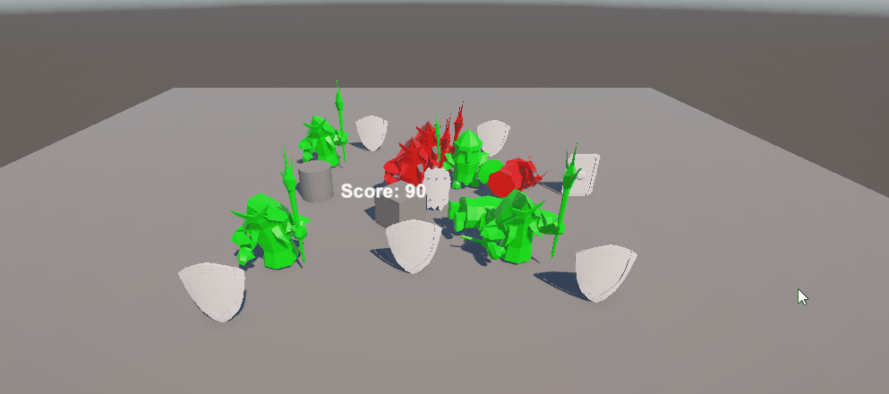
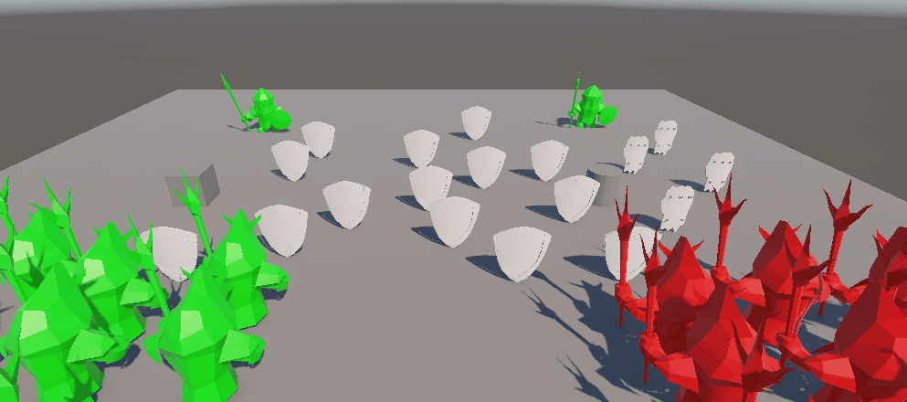

# Events, delegate and observer pattern

## Scripts

* **Exercise 1**:

The main purpose of this exercise is to implement an event-driven architecture 
using Unity delegates and events to coordinate group movement behaviors across 
multiple GameObjects upon collision detection.

The scene physics are configured so that the cylinder possesses a static 
Collider without a Rigidbody, while the moving cube includes a dynamic 
Rigidbody. This allows the cylinder to detect physical impacts via 
`OnCollisionEnter()` without moving itself. When the collision occurs, the 
cylinder broadcasts a static event `OnCubeCollided`. The red and green spheres 
subscribe to this event during `OnEnable()` and respond via callback functions 
according to their assigned tags.

Upon receiving the notification, red spheres calculate direction vectors toward 
a designated target green sphere, whereas green spheres target the cylinder's 
location. The movement is implemented directly using Transform displacement 
scaled by `Time.deltaTime`.

As a result, colliding the cube into the cylinder triggers synchronized 
tracking where (type1|red) spheres converge on the target sphere and 
(type2|green) spheres move cleanly through the cylinder towards its origin, as 
illustrated below.

* **Exercise 2**:

The main purpose of this exercise is to integrate 3D humanoid character assets 
into the existing scene.

The humanoid models were imported and assigned the corresponding identification 
tags, retaining the exact same script logic and event subscriptions from 
Exercise 1. Upon detecting the physical collision between the cube and the 
cylinder, the humanoid characters automatically trigger their movement callbacks 
and translate toward their assigned target positions across the scene.

* **Exercise 3**:

The main purpose of this exercise is use dynamic user-controlled inputs, event 
subscriptions, and custom stop conditions against physical target obstacles.

The cube is controlled dynamically by setting its linearVelocity via Rigidbody 
inputs, allowing it to navigate the scene and collide with either (type1|red) 
or (type2|green) humanoids. The humanoids feature static Collider components 
and broadcast distinct static events `OnCubeCollidedHumanoidRed` and 
`OnCubeCollidedHumanoidGreen` upon registering a physical collision with the 
cube. Subscribed humanoids move toward their respective target shields using 
direct Transform translation for uniform speed.

Unlike trigger-based zones, the target shields act as solid physical colliders 
without IsTrigger enabled. Because Transform movement bypasses physical 
blocking, a manual distance threshold (epsilon) is checked in `Update()` to 
halt translation once a humanoid reaches its shield. Additionally, physical 
contact with shields or other colliders triggers a color change via 
`OnCollisionEnter()`.

As a result, colliding the cube with specific humanoid groups triggers targeted 
movements toward solid shields, stopping smoothly upon arrival and updating 
colors upon contact, as illustrated in the GIF below.

* **Exercise 4**:

The main purpose of this exercise is to implement instantaneous spatial 
manipulation and directional orientation across different entity groups 
triggered by proximity event notifications.

The reference object monitors the cube's approach, broadcasting an event 
`OnCubeApproachedReference` when the proximity threshold is crossed. Both 
(type1|red) and (type2|green) humanoids subscribe to this event during 
`OnEnable()`. In this scenario, humanoids utilize `Rigidbody` components to 
handle positional updates through the physics engine rather than direct 
`Transform` translation.

When notified, (type1|red) humanoids instantaneously relocate to the target 
shield by setting `rigidbody.position` directly to the shield's coordinates, 
avoiding physics interpolation artifacts. Simultaneously, (type2|green) 
humanoids compute a planar direction vector toward their assigned orientation 
object, aligning their facing direction using `rigidbody.MoveRotation()` to 
ensure smooth physics-driven rotational alignment.

Additionally, the target shield's collider is not set as a trigger 
(IsTrigger = false), which causes the teleported humanoids to be forcefully 
ejected by physics solver forces upon instantaneous overlap.

* **Exercise 5**:

The main purpose of this exercise is to implement a collectible mechanics
system where shield objects act as spatial triggers to increase player score 
tracking.

The low-value (+5) and high-value (+10) shields feature `Collider` components 
set as triggers (`IsTrigger = true`), allowing the player's dynamic `Rigidbody` 
to detect intersections via `OnTriggerEnter()`. Overlapping a shield calculates 
the score addition based on custom tags without imposing physical barriers or 
affecting player momentum.

* **Exercise 6**:

The main purpose of this exercise is to integrate a Canvas-based UI system to 
display the player's score dynamically during gameplay.

Using `GameObject.FindGameObjectWithTag()`, the script retrieves the `Text` 
component embedded inside the Canvas UI. Upon accumulating points from 
collected shields, `UpdateScoreUI()` formats and writes the current score 
directly to the onscreen overlay text.

* **Exercise 7**:

The main purpose of this exercise is to introduce a milestone reward mechanism 
that notifies the player through the UI upon reaching score thresholds.

Inside `CheckReward()`, the system evaluates whether the score crosses 
multiples of 100 points (`rewardThreshold`). When triggered, it updates the 
designated reward `Text` element with a notification message, resetting or 
advancing the milestone target dynamically for continuous progression feedback.

* **Exercise 8**:

The main purpose of this exercise is to integrate the mechanics developed 
throughout the practice into a cohesive, interactive mini-game scenario 
combining collectible collection, proximity sensing, event-driven behaviors, 
and dynamic obstacles.

As a result, reaching the high-value collectible area activates active humanoid 
obstacles that intercept the player's path, blending event notification, 
trigger collection, and physical collision, as shown below.

* **Exercise 9 (Reflective Analysis)**:

The main purpose of this exercise is to evaluate the mechanical and physical 
implications of configuring the player-controlled cube as a fully dynamic 
physical object rather than a kinematic or transform-translated entity within 
Exercise 3's mechanics.

By attaching a dynamic `Rigidbody` (`IsKinematic = false`) to the cube, its 
movement shifts from direct positional control to force-driven physics governed 
by Newtonian mechanics. This change alters key interactions across the scene:

1. Collision Physics with Humanoids: When colliding with red or green 
humanoids, the cube no longer moves unyieldingly through them.
2. Event Dispatching Stability: Because dynamic collisions exert reactive 
forces, the cube can be pushed away from target humanoids instantly with 
contact.
3. Control & Navigation: Moving via physical forces or velocity updates 
requires handling momentum and stopping distances, adding physical inertia to 
player navigation when steering toward humanoids and shield targets.

As a result, making the cube a fully dynamic physical entity transforms rigid 
collisions into realistic impulse interactions, requiring precise velocity 
management while retaining event-driven notifications across the scene.
